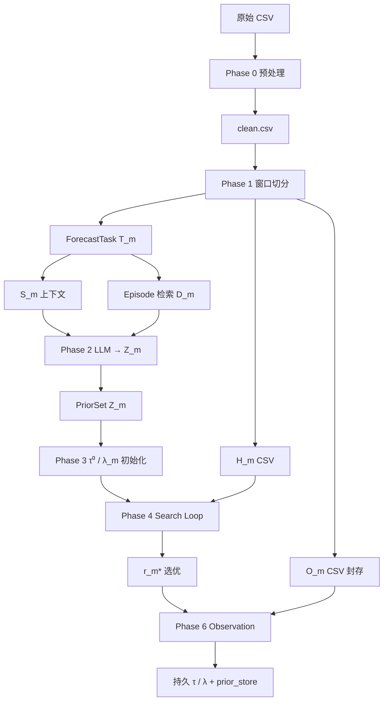

# prior_enhance 端到端逻辑文档

> **对应论文**：Evidence-Calibrated LLM Priors for Nonstationary Forecasting Recipe Search  
> **工程目录**：`prior_enhance/`  
> **入口**：`pipeline.py::PriorEnhancePipeline.run_single_window()` / `examples/run_demo.py`  
> **文档版本**：2026-06-12

---

## 目录

1. [总览：核心链条与信息边界](#1-总览核心链条与信息边界)
2. [入口与输出产物](#2-入口与输出产物)
3. [Phase 0：数据预处理](#3-phase-0数据预处理)
4. [Phase 1：窗口切分与预测任务 \(T_m\)](#4-phase-1窗口切分与预测任务-t_m)
5. [Phase 1.5：上下文状态 \(S_m\) 与 Episode 检索](#5-phase-15上下文状态-s_m-与-episode-检索)
6. [Phase 2：结构化 LLM Prior \(Z_m\)](#6-phase-2结构化-llm-prior-z_m)
7. [Phase 3：Prior 初始化（\(\tau^0\)、\(\lambda_m\)）](#7-phase-3prior-初始化tau0lambda_m)
8. [Phase 4：窗口内 Prior-Guided Search](#8-phase-4窗口内-prior-guided-search)
9. [Phase 5：最终方案选择与 O_m 推理](#9-phase-5最终方案选择与-o_m-推理)
10. [Phase 6：Observation Feedback 与持久 Memory](#10-phase-6observation-feedback-与持久-memory)
11. [模块—公式—文件对照总表](#11-模块公式文件对照总表)
12. [当前实现与论文差异（必读）](#12-当前实现与论文差异必读)

---

## 1. 总览：核心链条与信息边界

### 1.1 论文核心立场

**LLM generates testable priors, not forecasts.**

- LLM **不**直接输出预测数值；
- LLM **不**直接决定最终 recipe \(r_m^\*\)；
- LLM 只生成结构化 prior \(Z_m\)，经编译为 \(\phi_{j,m}(r)\)，再通过 \(\psi\)、采样分布 \(p\)、Gain \(G\)、可靠性 \(\tau\) 参与搜索与校准；
- 最终 \(r_m^\*\) **仅**由验证损失、成本、风险约束决定。

### 1.2 核心公式链条

\[
Z_m \;\to\; \phi_{j,m}(r) \;\to\; \psi_{m,k}(r) \;\to\; p_{m,k}(r) \;\to\; G_{j,m} \;\to\; \tau_{j,m}
\]

| 符号 | 含义 | 工程对象 |
|------|------|----------|
| \(Z_m\) | 结构化 prior 集合 | `PriorSet` / `priors_Zm.json` |
| \(\phi_{j,m}(r)\) | recipe 对 prior 的满足度 | `prior/compiler.py::phi_prior_recipe` |
| \(\psi_{m,k}(r)\) | 综合 prior 分 | `search/loop.py::_psi_score` |
| \(p_{m,k}(r)\) | 采样分布 | `search/proposal.py`（当前 \(\rho=0\) 时 \(p=q\)） |
| \(G_{j,m}\) | Validation / Observation Gain | `validation/gain.py` |
| \(\tau_{j,m}\) | 持久 prior 可靠性 | `observation/memory.py` + `prior_store` |

### 1.3 信息边界（防泄漏）

设全量数据 \(\mathcal{D}_{\text{full}}=\{(y_\tau,x_\tau)\}_{\tau=1}^T\)，窗口 \(m\) 决策时刻 \(t_m\)：

| 集合 | 定义 | 何时可用 |
|------|------|----------|
| \(\mathcal{H}_m\) | \(\{(y_\tau,x_\tau):\tau\le t_m\}\) | 搜索、LLM、内部 validation 全程 |
| \(\mathcal{O}_m\) | \(\{(y_\tau,x_\tau): t_m<\tau\le t_m+H\}\) | **仅** observation 阶段（未来揭晓后） |

**工程规则**：

- `run_prior_guided_search()` 只读 `history_df`（H_m），**不读** `oos_df`；
- 内部 validation 切分在 H_m 末尾再留 `val_horizon` 点，相对 train 是「未来」，相对 \(t_m\) 仍是合法历史；
- holdout 模式下：CSV 末尾 \(H\) 行落盘为 `{tag}_oos.csv`，搜索阶段禁止访问。

### 1.4 端到端流程图



---

## 2. 入口与输出产物

### 2.1 运行入口

```bash
# 推荐：mutiagent + AutoApex serve
bash prior_enhance/examples/run_mutiagent.sh \
  --clean-csv prior_enhance/outputs/preprocessed/代理购电_小时_clean.csv \
  --with-search --max-trials 8
```

代码路径：

```
run_demo.py
  └─ PriorEnhancePipeline.run_single_window(with_search=True)
       ├─ preprocess()
       ├─ build_tasks()        → T_m, S_m
       ├─ generate_priors()   → Z_m
       └─ run_search()         → SearchResult + ObservationResult
```

### 2.2 默认输出目录

`prior_enhance/outputs/` 下：

| 路径 | 内容 |
|------|------|
| `preprocessed/*_clean.csv` | 清洗后全量序列 |
| `windows/holdout/holdout_history.csv` | \(\mathcal{H}_m\) |
| `windows/holdout/holdout_oos.csv` | \(\mathcal{O}_m\)（搜索阶段不可用） |
| `results/holdout/task_Tm.json` | 预测任务 + \(S_m\) |
| `results/holdout/priors_Zm.json` | LLM 生成的 \(Z_m\) |
| `results/holdout/search_result.json` | 搜索摘要 |
| `results/holdout/observation_result.json` | O_m 反馈 + memory |
| `results/holdout/summary.json` | 运行总览 |
| `prior_store.jsonl` | 跨 run 历史 prior 库 |
| `logs/{run_id}*.log` | 透明日志 |

---

## 3. Phase 0：数据预处理

**模块**：`data/preprocessor.py`  
**公式/对象**：\(\mathcal{D}_{\text{full}}\)

### 3.1 输入

- 原始 CSV：至少含时间列 + 目标列（如 `timestamp`, `power`/`value`）
- 配置：`DataConfig`（`time_col`, `target_col`, `id_col`, `fill_method`, `freq`）

### 3.2 处理步骤

1. **列名归一化**：`date/time` → `timestamp`，`power` → `value`，补 `item_id`
2. **类型转换**：时间 → `datetime`，目标 → `float`，排序
3. **缺失填充**：
   - 优先 AutoApex `TimeSeriesDataFrame.clean_and_fill`（若环境可用）
   - 否则 pandas：`ffill/bfill/interpolate`，标记 `fill_flag`
4. **输出**：`{basename}_clean.csv`，行数 = 全量 \(T\)

### 3.3 与论文关系

此阶段构造论文中的 \(\mathcal{D}_{\text{full}}\)，尚未引入 \(t_m\) 或 \(\mathcal{H}_m/\mathcal{O}_m\) 划分。

---

## 4. Phase 1：窗口切分与预测任务 \(T_m\)

**模块**：`data/window.py`, `schemas.ForecastTask`  
**公式**：

\[
T_m = (\mathcal{H}_m,\, X_m^+,\, E_m,\, K_m,\, H,\, B,\, l)
\]

### 4.1 Holdout 窗口（默认）

**函数**：`build_holdout_window()`

设清洗后序列长度 \(n\)，预测跨度 \(H\)（默认 `forecast_days × points_per_day = 3×24 = 72`）：

\[
\mathcal{H}_m = \text{rows}[0 : n-H], \quad
\mathcal{O}_m = \text{rows}[n-H : n], \quad
t_m = \max(\text{timestamp in } \mathcal{H}_m)
\]

**例**：3600 行 → H_m=3528，O_m=72，决策时刻 = H_m 最后一行时间戳。

Rolling 模式（`window.mode=rolling`）由 `build_rolling_windows()` 生成多窗，**当前 pipeline 默认只取 `windows[0]`**，多窗链式实验待 `run_rolling()` 编排。

### 4.2 构建 \(T_m\)

**函数**：`build_forecast_task(window, config)`

| 分量 | 论文符号 | 工程实现 | 说明 |
|------|----------|----------|------|
| 历史数据 | \(\mathcal{H}_m\) | `task.history_path` → CSV | 搜索/训练唯一数据源 |
| 已知未来外生 | \(X_m^+\) | `task.known_covariates` | 字段存在，**多数场景为空**，未完整传入 AutoApex |
| 事件上下文 | \(E_m\) | `task.event_context` | 无外部事件时用 `parse_event_context()` 合成日历事件 |
| 领域知识 | \(K_m\) | `config.domain_knowledge` | 写入 LLM prompt |
| 预测跨度 | \(H\) | `task.horizon` | 默认 72 |
| 搜索预算 | \(B\) | `task.search_budget` / `SearchConfig.max_trials` | 默认 12~50 |
| 损失函数 | \(l\) | `task.loss_name` | 默认 `mape` |

### 4.3 Episode 检索 \(\mathcal{D}_m\)

**模块**：`data/episode_store.py`

\[
\mathcal{D}_m = \Retrieve(T_m, \mathcal{D})
\]

1. 从 \(\mathcal{H}_m\) 滑动切块构建 episode 库 \(\mathcal{D}\)（每块含场景标签、事件摘要 embedding 文本）
2. 按当前场景 \(c_m\)、事件语义相似度检索 top-k（默认 `episode_ref_k=10`）
3. 结果写入 `task.retrieved_episodes`，供 LLM prompt 与 \(b^{\text{evidence}}\) 使用

---

## 5. Phase 1.5：上下文状态 \(S_m\) 与 Episode 检索

**模块**：`context/state.py`, `context/event_novelty.py`, `context/labels.py`  
**公式**：

\[
S_m = (n_m,\, \nu_m,\, d_m) \in [0,1]^3
\]

### 5.1 有效样本量 \(n_m\)

\[
\mathcal{I}_m^{c} = \{\tau \le t_m : c_\tau = c_m,\; y_\tau \text{ valid}\}, \quad
n_m = \clip\left(\frac{N_m^{\mathrm{eff}}}{N_m^{\mathrm{ref}}}, 0, 1\right)
\]

- \(c_m\)：`scenario_label(decision_time)`（春节/国庆/工作日等）
- \(N_m^{\mathrm{eff}}\)：同类场景有效点数
- \(N_m^{\mathrm{ref}}\)：`scenario_ref_count()` 给出的参考样本上界

**代码**：`_compute_n_m()` → `ContextState.n_m`

### 5.2 事件新颖性 \(\nu_m\)

\[
\bm{e}_m = g(E_m), \quad
s_m^{\max} = \max_{E_i \in \mathcal{E}_m^{\mathrm{hist}}} \cos(\bm{e}_m, \bm{e}_i), \quad
\nu_m = 1 - s_m^{\max}
\]

- \(g(\cdot)\)：BGE 中文编码器（`context/text_encoder.py`）
- 历史事件池：同类场景 episode 的 `event_summary`

**代码**：`compute_event_novelty()`

### 5.3 分布漂移 \(d_m\)

场景内标准化 \(\tilde{y}\) 后，比较近期段 \(R_m\) 与历史可比段 \(C_m\)：

\[
d_m^{\mu} = \clip\left(\frac{|\bar{y}_m^r - \bar{y}_m^c|}{\delta_\mu}, 0, 1\right), \quad
d_m^{\sigma} = \clip\left(\frac{|\sigma_m^r - \sigma_m^c|}{\delta_\sigma}, 0, 1\right), \quad
d_m = d_m^{\mu} + d_m^{\sigma}
\]

**代码**：`_compute_d_m()`，\(\delta_\mu=\delta_\sigma=1.0\)

### 5.4 离散 cond 标签

**模块**：`context/labels.py`

| 连续值 | 分档规则 | 标签 |
|--------|----------|------|
| \(n_m\) | <0.33 / <0.66 / else | `low_sample` / `medium_sample` / `high_sample` |
| \(\nu_m\) | ≥0.5 / else | `novel_event` / `familiar_event` |
| \(d_m\) | <0.33 / <0.66 / else | `stable` / `moderate_drift` / `severe_drift` |

组合为 \(\text{cond}_{j,m}\) 的候选标签，写入 LLM prompt。

---

## 6. Phase 2：结构化 LLM Prior \(Z_m\)

**模块**：`prior/generator.py`, `prior/prompt_builder.py`, `prior/validator.py`, `prior/confidence.py`

### 6.1 生成流程

```
T_m + S_m + D_m + AutoApex 搜索空间
    → build_prior_generation_prompt()
    → DashScopeLLMClient 流式调用
    → JSON 解析 { "priors": [...] }
    → validate_prior_batch()  → Valid(z)=1
    → compute_b_evidence + blend_confidence → b_{j,m}
    → PriorSet
```

### 6.2 单条 prior 结构

\[
z_{j,m} = (\text{cond}_{j,m},\, \text{target}_{j,m},\, \text{action}_{j,m},\, b_{j,m})
\]

| 字段 | 含义 | Schema |
|------|------|--------|
| `cond` | 适用条件标签数组 | 应来自 \(S_m\) 离散标签 |
| `target` | 推荐配置簇 \(\mathcal{W},\mathcal{F},\mathcal{M},\Theta,\mathcal{E}\) | `PriorTargetClusters` |
| `action` | 负向规避 `avoid_*` 列表 | 映射到 `prior/compiler.py::AVOID_HANDLERS` |
| `b_llm` | LLM 自报置信度 | \([0,1]\) |

### 6.3 证据校准置信度

\[
b^{\text{evidence}}_{j,m} = 0.4\, n_m + 0.3\,(1-\nu_m) + 0.3\, \min\left(\frac{|\mathcal{D}_m|}{K}, 1\right)
\]

\[
b_{j,m} = \lambda\, b^{\text{LLM}}_{j,m} + (1-\lambda)\, b^{\text{evidence}}_{j,m}
\]

- \(\lambda\)：`PriorConfig.confidence_lambda`（默认 0.5）
- \(K\)：`PriorConfig.episode_ref_k`（默认 10）

**代码**：`prior/confidence.py`

### 6.4 Valid 过滤

\[
\Valid_m(z)=1 \Rightarrow z \in Z_m^{\text{valid}}
\]

检查项（`prior/validator.py`）：

- `cond` 标签在合法集合内
- `target` 字段落在 AutoApex 搜索空间
- `action` 为已知 `avoid_*` 关键字
- 无泄露性自然语言（`LEAKAGE_KEYWORDS`）

---

## 7. Phase 3：Prior 初始化（\(\tau^0\)、\(\lambda_m\)）

**模块**：`prior/compiler.py`, `prior/similarity.py`, `prior/llm_trust.py`, `observation/prior_store.py`  
**在搜索开始前执行**（`search/loop.py` 调用 `init_tau_loc()`）

### 7.1 持久可靠性检索 \(\tau_{j,m}\)

\[
\tau_{j,m} = \frac{\sum_{z_i \in \mathcal{P}_{j,m}} s(z_{j,m}, z_i)\,\tau_i}{\sum s + \epsilon}
\]

- \(\mathcal{P}_{j,m}\)：来自 `prior_store.jsonl` 的历史 prior，相似度 \(s \ge s_{\min}\)（默认 0.25）
- \(s(\cdot,\cdot)\)：`prior/similarity.py`（cond/target/action 集合重叠 + 15% BGE 语义）
- 无匹配 → \(\tau_{j,m}=0.5\)（无信息先验）

### 7.2 适用度 \(a_{j,m}\)

\[
a_{j,m} = a_j(S_m) = \frac{|\text{cond}_{j,m} \cap \text{labels}(S_m)|}{|\text{cond}_{j,m}|}
\]

**代码**：`applicability(prior, ctx)`

### 7.3 初始局部可靠性 \(\tau_{j,m,0}^{\text{loc}}\)

\[
\tau_{j,m}^0 = \clip\left(a_{j,m}\,\big[\lambda_m\, b_{j,m} + (1-\lambda_m)\,\tau_{j,m}\big],\; \epsilon_\tau,\; 1-\epsilon_\tau\right)
\]

\[
\tau_{j,m,0}^{\text{loc}} = \tau_{j,m}^0
\]

**代码**：`init_tau_loc()` → 字典 `{prior_id: τ}`

### 7.4 全局 LLM 信任 \(\lambda_m^{\text{init}}\)

\[
\lambda_m^{\text{init}} = \frac{score_m - score_{\min}}{score_{\max} - score_{\min} + \epsilon}
\]

- 数据来源：`prior/data/llm_leaderboard.csv`（205 模型，\(score_{\max}=61, score_{\min}=5\)）
- `llm.model` 严格匹配；**未命中** → \(score_m=5\) → \(\lambda=0\)
- **代码**：`resolve_lambda_m_init()` → `PriorMemory(lambda_m=...)`

---

## 8. Phase 4：窗口内 Prior-Guided Search

**模块**：`search/loop.py`, `search/proposal.py`, `validation/split.py`, `validation/evaluator.py`, `validation/objective.py`, `validation/gain.py`

### 8.1 内部 Train-Validation 切分

在 \(\mathcal{H}_m\) 内（**不**使用 \(\mathcal{O}_m\)）：

\[
\mathcal{H}_m \to (\mathcal{D}_{m}^{\text{train}}, \mathcal{D}_{m}^{\text{val}})
\]

约束：`max(train.time) < min(val.time)`，且 train/val ⊂ \(\mathcal{H}_m\)。

**代码**：`make_holdout_val_split(history_df, val_horizon=48)`  
（论文 \(B_{\text{val}}\) 多切片未实现，当前仅单切分）

### 8.2 Forecasting Recipe \(r\)

\[
r = (W,\, F,\, M,\, \theta,\, V,\, Q)
\]

**Schema**：`recipe/schema.py::ForecastingRecipe`

| 组件 | 含义 | 来源 |
|------|------|------|
| \(W\) | 样本窗口策略 | `SampleWindowSpec`（recent_50pct, exp_decay…） |
| \(F\) | 特征工程 | none / tsfresh_comprehensive |
| \(M,\theta\) | 模型族与超参 | AutoApex `MODEL_CATALOG` |
| \(V\) | 验证策略 | 当前 `enabled=False`，用 AutoApex 默认 |
| \(Q\) | 输出/集成 | point + optional ensemble |

### 8.3 Prior 满足度 \(\phi_{j,m}(r)\)

\[
\phi_{j,m}(r) \in [0,1]
\]

**编译逻辑**（`prior/compiler.py::phi_prior_recipe`）：

1. **正向**：target 各字段与 recipe 的 window/feature/model/ensemble 重叠度平均
2. **负向**：每条 `action` 对应 `AVOID_HANDLERS`，违反则 \(\phi=0\)

总满足度（多 prior 时）：

\[
\bar{\phi}(r) = \frac{\sum_j b_{j,m}\,\phi_{j,m}(r)}{\sum_j b_{j,m}}
\]

**代码**：`phi_total()`

### 8.4 综合 prior 分 \(\psi_{m,k}(r)\)

\[
\psi_{m,k}(r) = \sum_{z_{j,m} \in Z_m} \tau_{j,m,k}^{\text{loc}}\, \phi_{j,m}(r)
\]

**代码**：`_psi_score(recipe, prior_set, tau_loc)`

### 8.5 采样分布 \(p_{m,k}(r)\)

**论文**：

\[
q_{m,k}(r) \propto \exp\{\beta_k\, \psi_{m,k}(r)\}, \quad
p_{m,k}(r) = (1-\rho_k)\, q_{m,k}(r) + \rho_k\, p_{\text{exp}}(r)
\]

**当前实现**（`search/proposal.py`）：

1. 构建候选池（默认 48 个 recipe）：60% `prior_guided_recipe` + 40% `sample_random_recipe`
2. 对每个候选算 \(\psi\)
3. Softmax：\(w_r \propto \exp(\beta_k \psi_r)\)，\(\beta_k=1\)
4. 无放回抽 `batch_size` 个

**配置**：`use_softmax_proposal=True`, `explore_ratio=0.0` → **\(\rho_k=0\)**，即 \(p_{m,k}=q_{m,k}\)

**未实现**：结构化 \(p_{\exp}\)（random / low-prior / **anti-prior** 三路）、\(\rho_k>0\) 混合。

Legacy 路径（`use_softmax=False` 或 `explore_ratio>0`）：guide + random 两路采样。

### 8.6 评估每个 recipe：\(J^{\text{val}}\)

对每个候选 \(r\)：

1. **训练预测**：`evaluate_on_split(recipe, train_df, val_df)`
   - 默认 `eval_backend=autoapex` → `POST /api/train` + 推理
   - 失败可回退 proxy（SeasonalNaive / Ridge 等）
2. **目标函数**：

\[
J_{m,k}^{\text{val}}(r) = L_{m,k}^{\text{val}}(r) + \lambda_C\, C_m(r) + \mu_m\, R_{m,k}^{\text{val}}(r)
\]

| 项 | 实现 |
|----|------|
| \(L^{\text{val}}\) | MAPE（`validation/objective.py::mape`） |
| \(C_m(r)\) | 真实 `wall_time_sec/3600` 或模型族代理常数 |
| \(\mu_m\) | `0.2 + 0.4 d_m + 0.2 \nu_m`（\(\xi_m\) 未建模） |
| \(R^{\text{val}}\) | 峰值低估率 + 尾部 MAE 简化版 |

累积评估集：

\[
\mathcal{E}_{m,k} = \mathcal{E}_{m,k-1} \cup \mathcal{A}_{m,k}
\]

### 8.7 Validation Gain 与 \(\tau^{\text{loc}}\) 更新

**回归**（当前为一元 OLS，论文要求多元 + 混杂控制 \(x_m(r)\) 未完全实现）：

\[
J_{m,k}^{\text{val}}(r) = \alpha + \beta_{j,m,k}^{\text{val}}\, \phi_{j,m}(r) + \varepsilon
\]

\[
G_{j,m,k}^{\text{val}} = -\beta_{j,m,k}^{\text{val}}
\]

\[
\Delta_{j,m,k}^{\text{val}} = \clip\left(\frac{G_{j,m,k}^{\text{val}}}{\SE + \epsilon_G},\, -\Delta_{\max},\, \Delta_{\max}\right)
\]

**证据门控**：

\[
\chi_{j,m,k}^{\text{val}} = q_{\text{sample}} \cdot q_{\text{balance}} \cdot q_{\text{quality}} \cdot q_{\text{stability}}
\]

- 默认 `require_balance=False` → \(q_{\text{balance}}=0.7\) 占位
- \(\chi < \chi_{\min}\) → 拒绝更新，只记日志

**Logit 更新**（仅窗口内，**不写**持久 \(\tau_{j,m}\)）：

\[
l_{j,m,k}^{\text{loc}} = \logit(\tau_{j,m,k}^{\text{loc}})
\]
\[
l_{j,m,k+1}^{\text{loc}} = (1-\omega_{\text{val}})\, l_{j,m,k}^{\text{loc}} + \eta_{\text{val}}\, \chi_{j,m,k}^{\text{val}}\, \Delta_{j,m,k}^{\text{val}}
\]
\[
\tau_{j,m,k+1}^{\text{loc}} = \sigma(l_{j,m,k+1}^{\text{loc}})
\]

### 8.8 最终方案选择 \(r_m^\*\)

搜索预算耗尽后：

\[
r_m^\* = \arg\min_{r \in \mathcal{E}_m \cap \mathcal{F}_m} \left(J_m^{\text{val}}(r) + \kappa\, \SE_m(r)\right)
\]

- 当前 \(\kappa=0\)
- **不含** LLM 评分项（论文明确要求删除）

**代码**：`best = min(evaluated, key=J_val)`

### 8.9 保留审计集 \(\mathcal{E}_m^{\text{retain}}\)

\[
\mathcal{E}_m^{\text{retain}} = \mathcal{E}_m^{\text{top}} \cup \mathcal{E}_m^{\text{explore}}
\]

- \(\mathcal{E}^{\text{top}}\)：验证集上 J_val 最优的 top-k（默认 3）
- \(\mathcal{E}^{\text{explore}}\)：\(\phi\) 最低的 explore-k（默认 2），供 observation 对照

---

## 9. Phase 5：最终方案选择与 O_m 推理

**说明**：当前 pipeline 在 search 阶段已完成 \(r_m^\*\) 选择；对 retain 集合在 observation 阶段用 **全量 H_m** 重训并在 O_m 上评估。

### 9.1 全量重训（论文）

\[
f_m^\* = \Train(r_m^\*,\, \mathcal{H}_m)
\]

**代码**：`evaluate_on_oos()` 内部对 `history_df`（完整 H_m）调用 AutoApex train。

### 9.2 正式外推

\[
\hat{y}_{\mathcal{O}_m}^{r} = f_m^\*(X_m^+)
\]

**代码**：`/api/inference/v1`，预测长度 = `len(oos_df)`  
**限制**：\(X_m^+\) 外生变量传递不完整，当前主要为单变量时序。

---

## 10. Phase 6：Observation Feedback 与持久 Memory

**模块**：`observation/feedback.py`, `observation/memory.py`, `observation/prior_store.py`  
**触发条件**：holdout 模式下存在 `oos_df` 且 `--with-search`

### 10.1 观测目标 \(J^{\text{obs}}\)

对 \(r \in \mathcal{E}_m^{\text{retain}}\)：

\[
J_m^{\text{obs}}(r) = L_m^{\text{obs}}(r) + \lambda_C\, C_m(r) + \mu_m\, R_m^{\text{obs}}(r)
\]

形式同 \(J^{\text{val}}\)，但 \(L^{\text{obs}}\) 在真实 \(\mathcal{O}_m\) 上计算。

### 10.2 Observation Gain

\[
G_{j,m}^{\text{obs}} = -\beta_{j,m}^{\text{obs}}, \quad
J_m^{\text{obs}}(r) = \alpha + \beta_{j,m}^{\text{obs}}\, \phi_{j,m}(r) + \varepsilon
\]

同样经 \(\Delta^{\text{obs}}\)、\(\chi^{\text{obs}}\) 门控。

### 10.3 持久 \(\tau_{j,m}\) 更新（慢速）

\[
\omega_m = \omega_{\max}\, \sigma(\alpha_0 - \alpha_n n_m + \alpha_\nu \nu_m + \alpha_d d_m + \cdots)
\]

（当前为简化 sigmoid，系数与论文 \(\alpha_0,\alpha_n,\ldots\) 未完全对齐）

\[
l_{j,m+1} = (1-\omega_m)\, l_{j,m} + \eta_{\text{obs}}\, \chi_{j,m}^{\text{obs}}\, \Delta_{j,m}^{\text{obs}}
\]
\[
\tau_{j,m+1} = \sigma(l_{j,m+1})
\]

**重要**：此更新**仅**在 O_m 揭晓后进行；validation 阶段的 \(\tau^{\text{loc}}\) **不会**直接写入此处。

### 10.4 全局 \(\lambda_m\) 更新

\[
\lambda_{m+1} = (1-\eta_\lambda)\,\lambda_m + \eta_\lambda\, \frac{\sum_{j \in J_m} \chi_{j,m}^{\text{obs}}\, \tau_{j,m+1}}{\sum \chi + \epsilon}
\]

证据不足时 \(\lambda_{m+1}=\lambda_m\)。

### 10.5 Prior Store 持久化

observation 结束后，将本窗 valid priors + 更新后的 \(\tau\) 追加到 `prior_store.jsonl`，供**下一窗口** `init_tau_loc()` 相似检索。

---

## 11. 模块—公式—文件对照总表

| 阶段 | 论文对象/公式 | 主要代码 |
|------|---------------|----------|
| 预处理 | \(\mathcal{D}_{\text{full}}\) | `data/preprocessor.py` |
| 窗口 | \(\mathcal{H}_m, \mathcal{O}_m, t_m\) | `data/window.py` |
| 任务 | \(T_m\) | `data/window.py::build_forecast_task`, `schemas.py` |
| 检索 | \(\mathcal{D}_m=\Retrieve(\cdot)\) | `data/episode_store.py` |
| 上下文 | \(S_m=(n_m,\nu_m,d_m)\) | `context/state.py`, `event_novelty.py`, `labels.py` |
| Prior | \(Z_m, b_{j,m}\) | `prior/generator.py`, `confidence.py`, `validator.py` |
| 编译 | \(\phi_{j,m}(r)\) | `prior/compiler.py` |
| 初始化 | \(\tau_{j,m}, \tau^0, \lambda_m^{\text{init}}\) | `compiler.py`, `similarity.py`, `llm_trust.py` |
| 搜索 | \(\psi, q, p, \mathcal{E}_m\) | `search/loop.py`, `search/proposal.py` |
| 评估 | \(J^{\text{val}}, J^{\text{obs}}\) | `validation/evaluator.py`, `objective.py` |
| Gain | \(G^{\text{val}}, G^{\text{obs}}, \chi\) | `validation/gain.py` |
| 局部更新 | \(\tau^{\text{loc}}\) | `validation/gain.py::update_tau_logit` |
| 选优 | \(r_m^\*\) | `search/loop.py` |
| 训练推理 | \(\Train, \hat{y}_{\mathcal{O}_m}\) | `validation/autoapex_client.py` |
| 持久记忆 | \(\tau_{j,m+1}, \lambda_{m+1}\) | `observation/memory.py` |
| Prior 库 | \(\mathcal{P}_{j,m}\) | `observation/prior_store.py` |
| 编排 | 全流程 | `pipeline.py` |

---

## 12. 当前实现与论文差异（必读）

| 论文要求 | 当前状态 |
|----------|----------|
| \(p_{\exp}\) 三类 + anti-prior | ❌ 未实现 |
| \(\rho_k>0\) 混合探索 | ❌ 默认 \(\rho=0\) |
| 多元 Gain + \(x_m(r)\) 混杂控制 | ❌ 一元 OLS |
| \(B_{\text{val}}\) 多切片 | ❌ 单切片 |
| \(\xi_m\)、Coverage 约束、概率 \(Q\) | ❌ 未建模 |
| rolling 多窗 pipeline 编排 | ⚠️ 代码有 `build_rolling_windows`，pipeline 默认单窗 |
| \(X_m^+\) 完整接入 | ⚠️ 字段有，推理未完整传递 |
| Softmax \(q_{m,k}\) | ✅ \(\beta_k=1\) |
| \(\tau_{j,m}\) 相似检索 + prior_store | ✅ |
| \(\lambda_m^{\text{init}}\) 排行榜 CSV | ✅ |
| AutoApex 真实 train/infer | ✅ 默认 backend |
| \(r_m^\*\) 无 LLM 项 | ✅ |
| Validation 反馈不写持久 \(\tau\) | ✅ |

---

## 附录 A：一次 holdout run 的时间线（概念）

```
t=0   读取 CSV，清洗 → D_full
t=1   切分：前 n-H 行 = H_m，后 H 行 = O_m（O_m 上锁）
t=2   从 H_m 算 S_m、检索 D_m、合成 E_m
t=3   LLM 生成 Z_m，校准 b
t=4   从 prior_store 初始化 τ⁰；从排行榜初始化 λ_m
t=5   loop: 采样 recipe → AutoApex 在 H_m 内 train/val → J_val
      → 更新 τ_loc（仅内存）
      → 直至 max_trials
t=6   选 r* = argmin J_val
t=7   【O_m 解锁】对 retain 集合：全 H_m 训练 → O_m 上 J_obs
t=8   算 G_obs → 更新持久 τ、λ → 写入 prior_store.jsonl
```

---

## 附录 B：关键配置项速查

| 配置 | 默认值 | 论文字符 |
|------|--------|----------|
| `window.forecast_days × points_per_day` | 72 | \(H\) |
| `search.max_trials` | 12 | \(B\) |
| `search.val_horizon` | 48 | 内部 val 长度 |
| `search.beta_k` | 1.0 | \(\beta_k\) |
| `search.explore_ratio` | 0.0 | \(\rho_k\) |
| `search.proposal_pool_size` | 48 | 候选池 |
| `search.prior_similarity_min` | 0.25 | \(s_{\min}\) |
| `prior.confidence_lambda` | 0.5 | \(b\) 融合 \(\lambda\) |
| `search.chi_min` | 0.25 | \(\chi_{\min}\) |
| `search.omega_val / eta_val` | 0.2 / 0.15 | \(\tau^{\text{loc}}\) 更新 |
| `search.eta_obs / eta_lambda` | 0.1 / 0.05 | 持久更新 |

---

*维护：代码变更后同步更新 §8.5、§12 与 `IMPLEMENTATION_PLAN.md`。*
